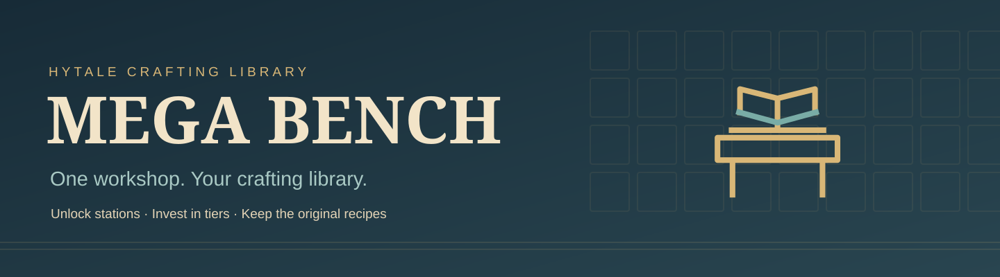

# Mega Bench

[Player guide](https://jkswoods.github.io/mega-bench/) · [Getting started](docs/getting-started.md) · [Report an issue](https://github.com/jkswoods/mega-bench/issues)



One placeable workshop gives you a native crafting library for compatible Hytale benches. Pay a station's original recipe ingredients to unlock its capability, invest in its original tier upgrades, then search and craft its recipes from one screen. Unlocks belong to each player in that world.

- Workbench selection, unlocks and upgrades on the left.
- A searchable recipe grid with original category tabs in the centre.
- Ingredient counts, output, time and quantity controls on the right.
- Original native crafting, with batches of 1–16 and native cancellation/refunds.
- Initial ordinary crafting adapters for stock benches, Emberworks Workbench and Foundry Floor.


**Alpha 0.1.0-alpha.1 · Hytale 0.7.4 · Java 25.** The exact native-checked JAR is submitted to [CurseForge](https://www.curseforge.com/hytale/mods/mega-bench) and is **under review**. Public availability depends on moderator approval. Use a separate backed-up world; actual second-player checks and player visual/listening review remain pending. Processing, builder and special plugin stations need separate adapters.

The current Alpha UI screenshots use native item icons. Placed-bench photos and the unlock/upgrade walkthrough retain the unchanged model and panel layout from 0.1.0-spike5r1.

## Build from source

Use JDK 25 and the pinned official Hytale server listed in `config/target.json`. The build reads that separately installed server to compile; it does not package the server, game artwork or compatibility artwork. UI icons and native Common.ui styles are resolved from the player's installed game/mods at runtime.

```sh
python3 tools/build.py \
  --java-home /path/to/jdk25 \
  --server-jar /path/to/HytaleServer.jar
```

`MB_JAVA_HOME` and `MB_SERVER_JAR` may supply those paths; `JAVA_HOME` is a fallback for the JDK. Optional Emberworks and Foundry Floor are installed separately at runtime and are not required for building the mod.

The build compiles the plugin, runs the progress tests and writes `build/libs/MegaBench-0.1.0-alpha.1.jar`. With the pinned inputs its SHA256 is `dff77ac3f030d58f8c440ab34682fd54f16796e30a8f0807c04fd5ea7970bdf0`. Checked-in native models, UI sources and original textures are editable; normal builds do not regenerate artwork or audio.

## Build the guide

```sh
python3 -m venv .venv-docs
.venv-docs/bin/python -m pip install -r requirements-docs.txt
MB_DOCS_PYTHON=.venv-docs/bin/python bash tools/build_player_guide.sh
```

The strict build writes `build/player-site/`. GitHub Pages deployment uses a manually dispatched workflow on `main`; pull requests only build the guide.

Mega Bench's original code and assets use the [MIT License](LICENSE). Game assets and third-party components retain their own terms; see [third-party notices](THIRD_PARTY_NOTICES.md).
