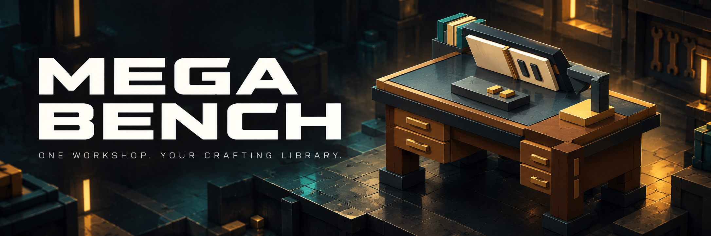
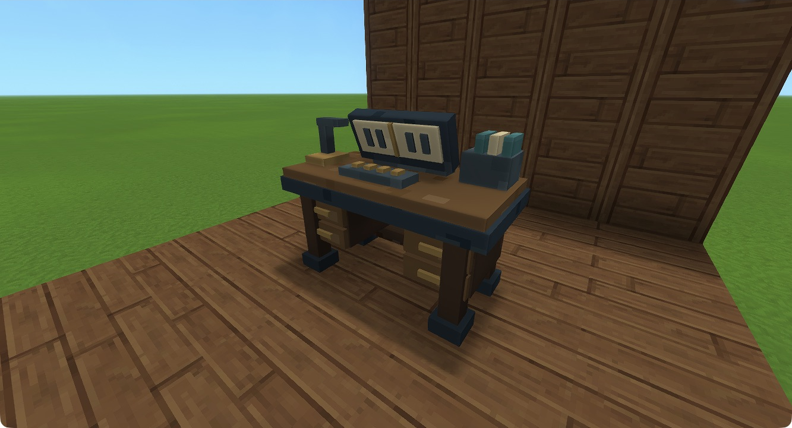
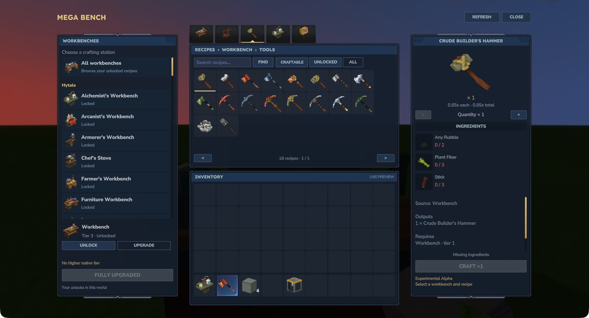

# Mega Bench

[Player guide](https://jkswoods.github.io/mega-bench/) · [Getting started](https://jkswoods.github.io/mega-bench/hytale0.7/getting-started/) · [Report an issue](https://github.com/jkswoods/mega-bench/issues)



One placeable workshop gives you a native crafting library for compatible Hytale benches. Pay a station's original recipe ingredients to unlock its capability, invest in its original tier upgrades, then search and craft its recipes from one screen. Unlocks belong to each player in that world.

- Workbench selection, unlocks and upgrades on the left.
- A searchable recipe grid with original category tabs in the centre.
- Ingredient counts, output, time and quantity controls on the right.
- Creative mode offers all supported bench tiers without ingredient or personal unlock payments; returning to Survival keeps your paid progress.
- Original native crafting, with batches of 1–16 and native cancellation/refunds.
- Initial ordinary crafting adapters for stock benches, Emberworks Workbench and Foundry Floor.





**Hytale 0.7 · Java 25 · Development preview.** Select compatible files from [CurseForge](https://www.curseforge.com/hytale/mods/mega-bench) or [GitHub releases](https://github.com/jkswoods/mega-bench/releases), reading their exact game-patch requirements and release notes. Use a separate backed-up world; actual second-player checks and player visual/listening review remain pending. Processing, builder and special plugin stations need separate adapters.

The UI screenshots use native item icons. Placed-bench photos and the unlock/upgrade walkthrough retain the same model and panel layout in earlier native captures.

## Other mod workbenches

The Hytale 0.7 support branch discovers ordinary native crafting benches from any enabled pack, without mod-specific optional dependencies. It preserves original recipes and tier data; benches without a suitable craft recipe offer an explicit hand-in of one physical bench. Server exclusions and identity overrides are documented in [Other workbench support](https://jkswoods.github.io/mega-bench/hytale0.7/bench-support/). Special processing and custom plugin stations still need dedicated adapters. Check the selected download’s release notes for feature availability.

## Build from source

Use JDK 25 and the pinned official Hytale server listed in `config/target.json`. The build reads that separately installed server to compile; it does not package the server, game artwork or compatibility artwork. UI icons and native Common.ui styles are resolved from the player's installed game/mods at runtime.

```sh
python3 tools/build.py \
  --java-home /path/to/jdk25 \
  --server-jar /path/to/HytaleServer.jar
```

`MB_JAVA_HOME` and `MB_SERVER_JAR` may supply those paths; `JAVA_HOME` is a fallback for the JDK. Optional Emberworks and Foundry Floor are installed separately at runtime and are not required for building the mod.

The build compiles the plugin, runs the progress, compatibility and Creative access tests and prints the mod JAR filename under `build/libs/`. Use the build or release output for that artifact’s checksum. Checked-in native models, UI sources and original textures are editable; normal builds do not regenerate artwork or audio.

## Documentation

The [versioned player guide](https://jkswoods.github.io/mega-bench/) is maintained on the separate [`docs` branch](https://github.com/jkswoods/mega-bench/tree/docs). In that checkout, run `npm ci --ignore-scripts`, `npm run build` and `npm run check`. Select `docs` when manually dispatching its Pages workflow.

Mega Bench's original code and assets use the [MIT License](LICENSE). Game assets and third-party components retain their own terms; see [third-party notices](THIRD_PARTY_NOTICES.md).

## Compatibility and builds

Current source targets Hytale `>=0.7.4 <0.8.0` and uses the `hytale0.7` support branch. See [build and release instructions](https://jkswoods.github.io/mega-bench/hytale0.7/build-and-release/) for the SDK pin, candidate checks, versioned filenames and CurseForge workflow.

## Contributing

See [the contribution guide](CONTRIBUTING.md) for feature and bug-fix PR targets.
Maintainers handle forward/back ports, and support-branch PRs require owner approval.

The player guide follows the Hytale support line and is updated independently of mod releases. Select downloads by their game compatibility and read the selected file’s release notes for included changes and artifact checksums.
