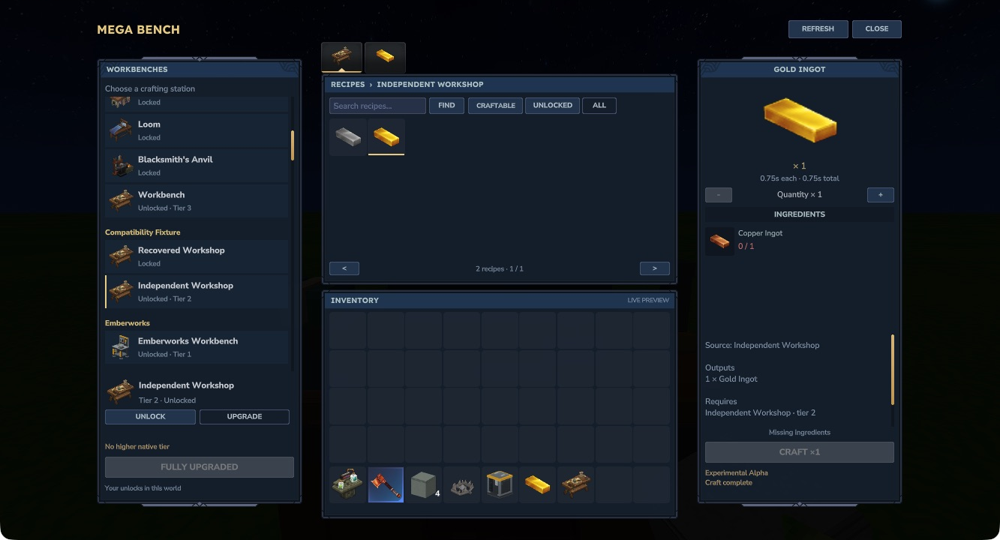
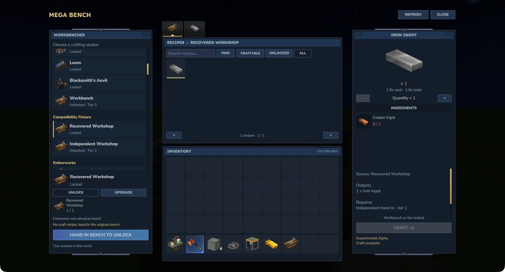

# Support for other workbenches

**Added in the 0.1.0-alpha.2 test build.** This build has not been uploaded to CurseForge. Mega Bench discovers ordinary native crafting benches from the packs enabled in the world. No mod-specific optional dependencies or item-name prefixes are required. It reads the original registered recipes, categories, ingredients, outputs and tier data. Other mods are installed separately.

## Unlock a discovered bench

Choose it in the left panel. If the bench has an ordinary recipe producing one bench, pay that recipe's original ingredients and meet its original recipe knowledge, world memories and bench-tier prerequisites. Alternative recipes remain separate choices.

If no suitable bench recipe is registered, the left panel offers **Hand in bench to unlock**. Bring one physical copy of the displayed bench. This action consumes it and unlocks tier one for you in that world; it does not give a second copy back. Higher tiers still require their original upgrade payments. A physical bench's upgraded tier is not imported.

Your previous unlocks and tiers retain the same bench IDs and saved format. Close and reopen the library to discover newly registered content. Restart the world/server after changing enabled mods or compatibility settings.

[](assets/screenshots/discovered-bench.png)

*Hytale 0.7.4, Mega Bench 0.1.0-alpha.2. This private fixture pack deliberately uses unfamiliar bench IDs. The pictured Copper-to-Gold recipe is a test recipe and is not included in Mega Bench.*

[](assets/screenshots/bench-hand-in.png)

*The fixture's no-recipe bench requires one actual bench item. The native check consumed it once, crafted through its original recipe and retained the purchased capability after reload.*

## Server compatibility settings

Mega Bench creates `compatibility.json` in its plugin data directory on first startup and prints that location in the server log. In singleplayer, it is inside the world save at `mods/MegaBench_MegaBench/compatibility.json`. Stop the world/server before editing it. The defaults are:

```json
{
  "Schema": 1,
  "AutoDiscover": true,
  "AllowBenchHandIn": true,
  "Benches": {}
}
```

`AutoDiscover` enables ordinary native crafting benches from every loaded pack. Set it to `false` to allow only benches explicitly listed under `Benches`. `AllowBenchHandIn` controls the physical-bench fallback when there is no suitable original unlock recipe.

Rules use the **native bench ID**, shown in the station's tooltip, rather than its item ID or translated name. For example:

```json
{
  "Schema": 1,
  "AutoDiscover": true,
  "AllowBenchHandIn": true,
  "Benches": {
    "ExampleWorkshop": {
      "Group": "Example mod",
      "ItemId": "Example_Workshop_Item",
      "UnlockRecipeId": "Example_Workshop_Recipe"
    },
    "IncompatibleWorkshop": {
      "Disabled": true
    }
  }
}
```

Replace the example IDs with real loaded asset IDs. `Group` changes the list heading. `ItemId` selects a representative physical item already belonging to that bench. `UnlockRecipeId` selects an existing recipe that makes exactly one of that bench's items. It does not create a recipe or change its costs. Incorrect explicit mappings disable that bench with a reason; they cannot turn a missing recipe into a free unlock. A disabled bench keeps its saved purchases but cannot be used through Mega Bench while disabled. Invalid settings produce a startup error rather than silently enabling content.

## Benches requiring dedicated support

Furnaces, fuel processors, diagram/structural stations and custom Java bench or block subclasses remain unavailable. Augment-dependent recipes are not supported. A configuration rule cannot convert these systems into ordinary crafting.

A mod can also enforce extra gameplay rules in its own plugin. Automatic discovery does not guarantee compatibility with every such rule. Keep that station excluded until a dedicated adapter preserves its behaviour. The original station remains available for its intended use.
