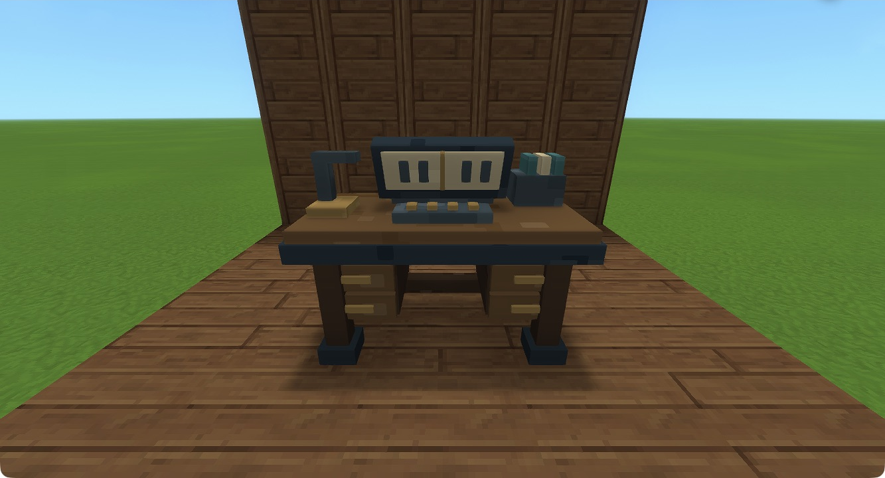
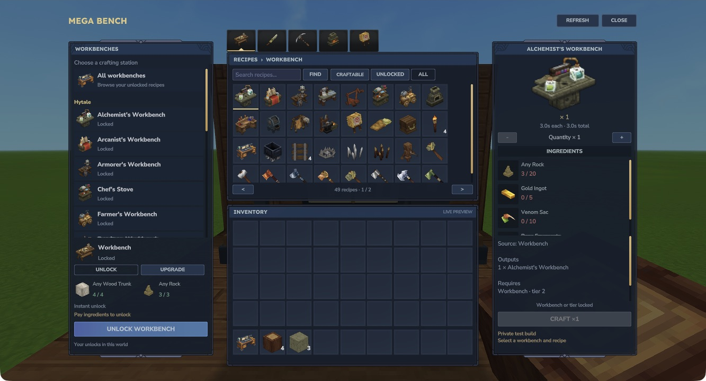
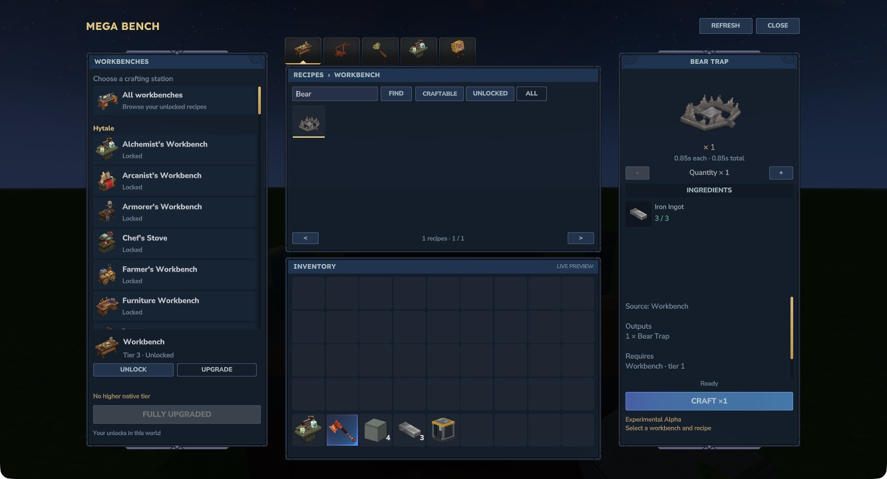
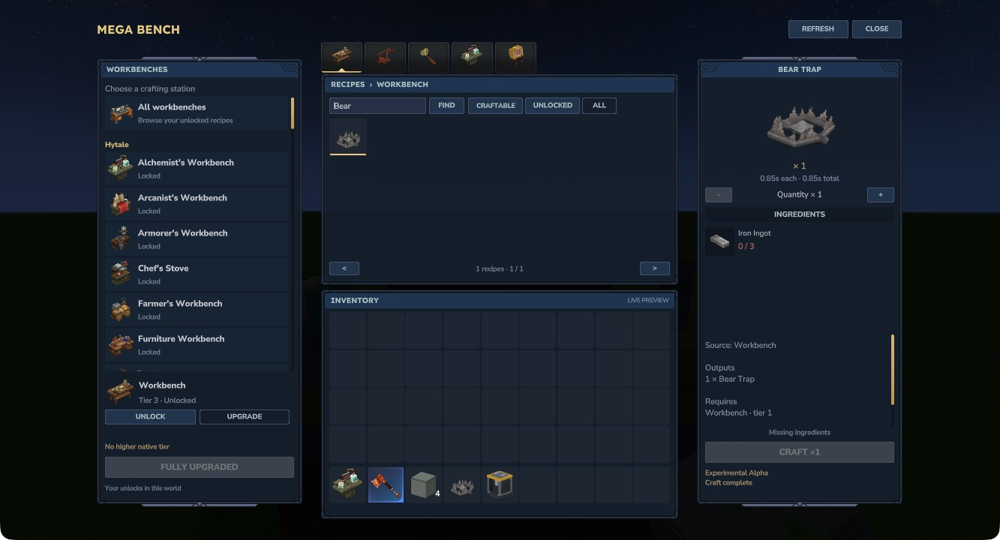
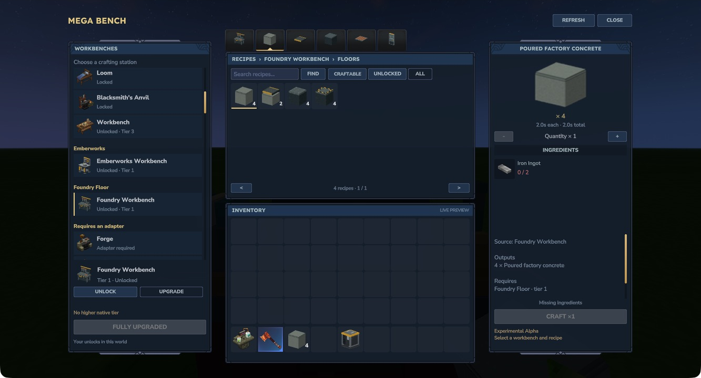

# Mega Bench in Hytale

The recipe browser, native craft and compatibility images show **Mega Bench 0.1.0-alpha.1 in Hytale 0.7.4**. The placed-bench photos and unlock/upgrade walkthrough are from **0.1.0-spike5r1**, with the same model and panel layout. These are actual native screenshots. Photography scenes may use Creative setup and supplied test ingredients; they do not prove a complete survival progression route.

Open a screenshot to view it at full size, especially when reading UI labels on a phone.

## The placed bench

*The book display, tool rack, brass controls and storage drawers on the original bench.*

*The front of the placed bench, with the HUD hidden for photography.*

## Unlock and upgrade

*Pay four wood trunks and three rock for your first Workbench capability.*

*Inspect and pay tier upgrades beneath the workbench list.*

## A native craft

*The source recipe keeps its original three-ingot cost.*

*The finished item appears in the live inventory preview after the original native queue completes.*

## Recipe browser

*Personal tiers and station controls stay on the left, selected recipe details on the right.*

## Original categories

*The original Emberworks tabs remain available inside the library.*

## Original outputs

*One Foundry craft produces its original four-block output.*
