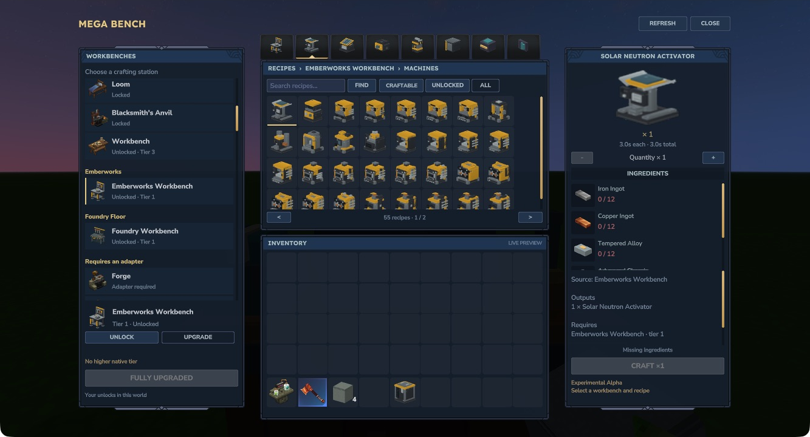

# The crafting library

## Choose a station on the left

The source list groups workbenches by mod and shows **Locked**, **Unlocked · Tier N** or paid work in progress. Select one to place its **Unlock** and **Upgrade** controls below the list. If several original recipes can unlock that station, use the recipe arrows to choose one; its costs are shown before payment.

A station marked **Adapter required** keeps its own original interface. Use it directly.

## Find a recipe in the centre

Search uses recipe names, item names and source identity. Press **Find** after entering text. With **All workbenches** selected, search spans your unlocked stations. A selected station offers its original category tabs.

- **All** shows recipes within the current source/search selection.
- **Unlocked** narrows the list to your paid bench and tier requirements.
- **Craftable** also checks known recipes and available ingredients for the chosen quantity. The server still checks output space and current state before accepting work.

*Mega Bench 0.1.0-alpha.1 in Hytale 0.7.4. Emberworks retains Machines, Power, Transport, Storage, Multiblocks, Components and Upgrades.*

## Check the recipe on the right

The right panel shows the output, source, ingredient counts, crafting time and original progression requirements. Green counts mean you have enough; red counts identify missing ingredients.

Use **−** and **+** for **1–16 crafts**. Costs, output quantities and total time update together. This changes crafting quantities without changing the selected station's unlock or upgrade cost.

Only one native crafting job runs at a time. **Cancel craft** and closing the interface use the native cancellation/refund path. A completed unit remains yours if you cancel a later unit in a batch. Keep room for every output before starting.

The inventory beneath the recipe grid is read-only. It updates to match the server inventory, but items are organised through the normal inventory screen.

[Unlocks and upgrades](progression.md) · [Troubleshooting](troubleshooting.md)
