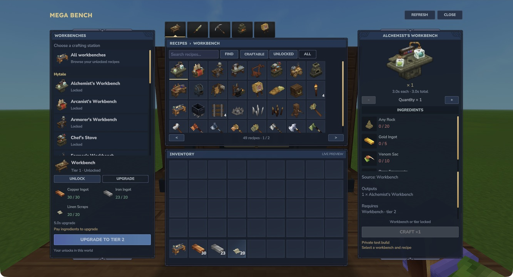

# Unlocks and upgrades

Every supported station has a personal capability in that world. Another player's purchase is intended to stay separate, and moving or replacing your Mega Bench keeps your own saved progress. Actual second-player testing is still pending.

## Unlock a station

Choose it in the left list and pay a valid original bench recipe. Original tier, knowledge and source prerequisites still apply. A timed unlock completes after the displayed duration. Missing ingredients leave the purchase unavailable.

Unlocking buys access in the library. It does not award a free physical station. Recipes above your paid tier remain locked even if you already have their ingredients.

## Upgrade the stock Workbench

| Target | Original materials | Upgrade duration |
| --- | --- | --- |
| Workbench capability, tier 1 | 4 wood trunks + 3 rock | Instant |
| Tier 2 | 30 Copper Ingots + 20 Iron Ingots + 20 Linen Scraps | 5 seconds |
| Tier 3 | 30 Thorium Ingots + 20 Cobalt Ingots + 30 Heavy Leather + 50 Shadoweave Scraps + 25 Fire Essence | 10 seconds |

Select **Upgrade** below the left workbench list. The server charges the full original cost once. The station waits for its paid upgrade before crafting. When the source station has no next upgrade, the control shows **Fully upgraded**.

*Select Upgrade to inspect the next tier. Green counts show that the displayed inventory meets the original payment.*

Other supported stations use their own installed source costs and duration. The table above is the stock Workbench progression for Hytale 0.7.4, not a universal upgrade schedule.

## Save your progress

Capabilities, tiers and remaining paid unlock/upgrade time are saved per player in that world. Normal reload and replacing the Mega Bench preserve that progress. Keep complete matching world and player backups before changing development versions.

[Original recipe examples](recipes.md) · [Compatibility](compatibility.md)
