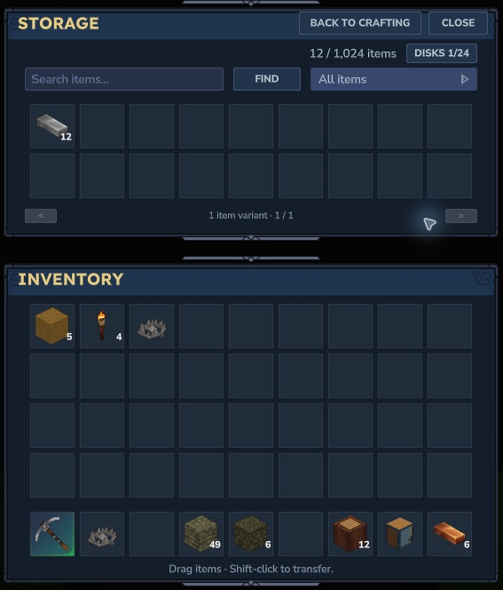

# Storage companions

Mega Bench can use **Companion API 1** to connect a separately installed storage addon. The base still works on its own. Check the chosen companion's required Mega Bench version and both downloads' game compatibility before installing.

## Connect storage to your workshop

1. Stop the game or server and back up the complete world/player data with its matching mod files.
2. Install one compatible Mega Bench base JAR and the companion's own JAR. Enable both in the same world. Keep only one base JAR across the main Mods directory and that save's `mods` directory.
3. Follow the companion's guide to obtain, place and connect its storage. The addon controls capacity, connection rules, ownership and storage recipes.
4. Open Mega Bench. With a compatible companion installed, the footer below Crafting shows its storage connection status. Follow its guidance if disconnected.
5. Choose **Open storage** to use the companion screen. **Back to crafting** returns to the selected workbench and recipe context.
6. In Survival, choose an already unlocked recipe and check the ingredient-source label and owned quantities before crafting. Make room in your normal inventory for every output.

*Hytale 0.7.5 with a compatible storage companion. The addon supplies the Storage screen, disk controls and capacity. This capture shows separate native Storage and Inventory panes; it is not the standalone base screen.*

## What changes when crafting

Permitted companion ingredients supplement player inventory in Survival, with player inventory checked first. The original recipe, knowledge, personal workbench unlock and paid tier still apply. Mega Bench's native crafting manager takes ingredients, produces outputs and handles cancellation/refunds. Keep free space in player inventory even when ingredients are stored elsewhere.

**Unlocks and workbench upgrades still take payment from player inventory.** Storage access does not grant a bench or tier. Creative keeps its existing native free-crafting path and does not consume companion ingredients. Switching back to Survival restores your paid progression.

The companion may pause transfers or hold its storage connection while crafting. Finish or cancel the active craft before moving its disks or changing the connection. Follow that addon's controls and restrictions rather than assuming every storage mod behaves the same way.

## Compatibility and Alpha limits

Only addons implementing the compatible API can provide extra ingredients. Mega Bench does not connect arbitrary chests or implement recursive crafting through this API. One storage companion provider is supported at a time.

Paired native checks in Hytale 0.7.5 covered a paid stock Workbench craft using stored ingredients, a batch drawing ingredients across connected racks, and ordinary save/rejoin with contents and player inventory retained. Those examples do not establish every addon, recipe or network arrangement.

Actual second-player ownership/contention, connection changes during crafting, and human visual/listening review remain pending. Use a backed-up test world for Alpha playtesting. See [Compatibility and multiplayer](compatibility.md) and the selected downloads' release notes.

## If storage does not appear

- Check that the installed base provides the API required by the companion. Older Mega Bench files may not include it.
- Check that both mods are enabled in this world and that only one Mega Bench base JAR is installed.
- Follow the companion's placement, ownership and connection rules. An installed companion can show a disconnected footer until its storage is usable.
- If crafting refuses, check the original bench/tier/knowledge requirements and space for all outputs in player inventory.

Keep your backup intact when reporting an issue. Include the game version, both mod versions and the exact action/error, while removing personal data from logs.
